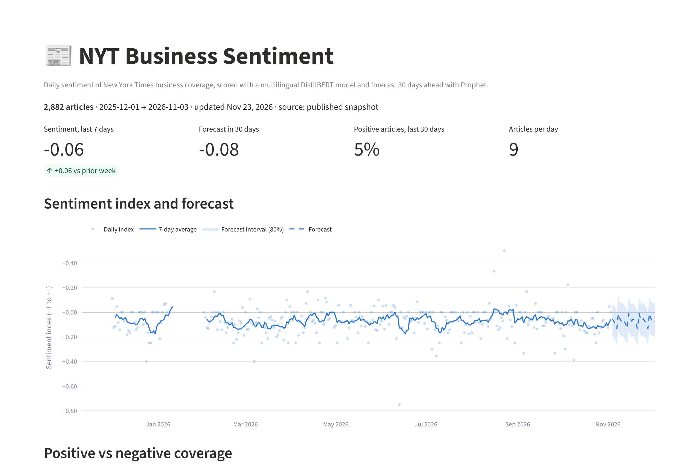
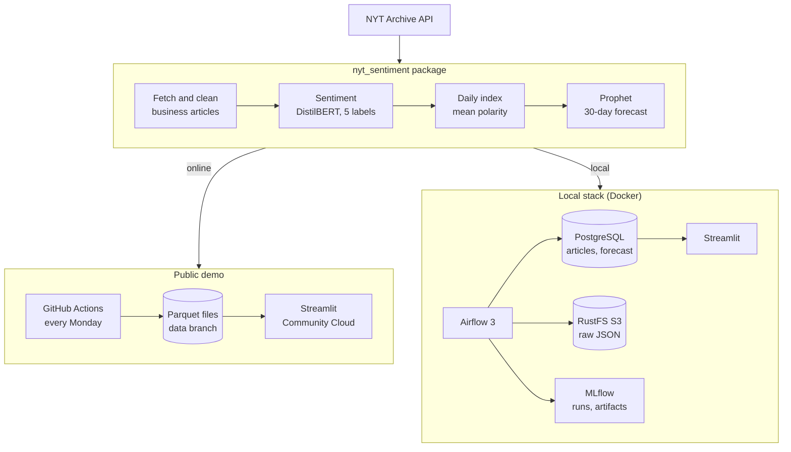

# NYT Business Sentiment: forecasting the tone of New York Times business news

[](https://nyt-business-sentiment.streamlit.app)
[](https://github.com/cnoret/nyt-business-sentiment/actions/workflows/tests.yml)
[](https://github.com/cnoret/nyt-business-sentiment/actions/workflows/refresh-data.yml)


[](LICENSE)

**An end-to-end MLOps pipeline that scores every NYT business article with a DistilBERT sentiment model and forecasts a daily sentiment index 30 days ahead: negative articles outnumber positive ones about 4 to 1, for an average index of −0.07.**

**Data:** 2,882 articles · NYT Archive API, Business section · Dec 2025 → Nov 2026 · about 9 articles a day, refreshed every week

**Live app:** <https://nyt-business-sentiment.streamlit.app>



## What it shows

| | |
|---|---|
| **Sentiment mix** | 80.5% neutral, 15.5% negative, 3.9% positive |
| **Average index** | −0.07 on a −1 to +1 scale: business coverage leans slightly pessimistic |
| **Lowest months** | October 2026 (−0.10) and March 2026 (−0.10) |
| **Forecast** | Prophet with weekly seasonality, 30 days ahead with an 80% interval |

Figures from the first backfill (November 2026); the live app always shows the latest weekly refresh.

## How it works



1. **Ingestion.** The [Archive API](https://developer.nytimes.com/docs/archive-product/1/overview) returns every article of a month; only the Business section is kept, and requests are paced to respect the 5-per-minute limit.
2. **Sentiment.** [`tabularisai/multilingual-sentiment-analysis`](https://huggingface.co/tabularisai/multilingual-sentiment-analysis) labels each headline and abstract on a five-point scale, mapped to −1, −0.5, 0, +0.5 and +1.
3. **Index.** The daily index is the mean polarity of the day's articles, alongside the share of positive and negative articles.
4. **Forecast.** Prophet is refit on the full history at every run.

All steps live in one tested package, `src/nyt_sentiment`, shared by two orchestrators:

- **Online**, a weekly GitHub Actions job runs `nyt-sentiment snapshot`, scores only the new articles and publishes Parquet files to the [`data`](https://github.com/cnoret/nyt-business-sentiment/tree/data) branch, which the Streamlit app reads. The demo needs no server, database or secret.
- **Locally**, an Airflow DAG (`fetch_raw_articles → score_new_articles → forecast_sentiment`) stores raw payloads in S3-compatible storage, upserts articles into PostgreSQL and tracks every forecast run in MLflow.

## Run it locally

Requirements: Docker with about 4 GB of memory and a free [NYT API key](https://developer.nytimes.com) with the Archive API enabled.

```bash
cp .env.example .env          # add your NYT_API_KEY
docker compose up -d --build
```

| Service | URL |
|---|---|
| Airflow (no login locally) | <http://localhost:8080> |
| MLflow | <http://localhost:5000> |
| Streamlit | <http://localhost:8501> |
| RustFS S3 console | <http://localhost:9001> |

Unpause and trigger `nyt_sentiment_pipeline` in Airflow, with `lookback_months` set to 12 for a first backfill. The first run downloads the sentiment model (about 500 MB).

Without Docker, the file-based mode is enough to rebuild the snapshot and open the app:

```bash
pip install torch --index-url https://download.pytorch.org/whl/cpu
pip install -e ".[ml]" -r streamlit/requirements.txt
NYT_API_KEY=... nyt-sentiment snapshot --months 3
streamlit run streamlit/app.py   # reads ./data
```

## Tests

```bash
pip install -r requirements-dev.txt && pip install --no-deps -e .
python -m pytest            # set TEST_DATABASE_URL to also run the PostgreSQL tests
ruff check src tests airflow streamlit
```

The suite covers the API client (errors, retries, rate-limit pacing), cleaning, the polarity mapping, the daily index, the Prophet forecast, idempotent PostgreSQL writes, the incremental snapshot and a Streamlit `AppTest` smoke test. GitHub Actions runs it on every push and pull request, against a PostgreSQL service.

## Project structure

```text
src/nyt_sentiment/   ingestion, cleaning, sentiment, forecast, storage, snapshot CLI
airflow/             Airflow 3 image and DAGs (pipeline + dashboard health check)
streamlit/           dashboard and its data loader (PostgreSQL, URL or local Parquet)
docker/              PostgreSQL init script and MLflow image
tests/               unit, integration and app tests
.github/workflows/   CI (tests.yml) and weekly data refresh (refresh-data.yml)
```

## Design notes

- **Archive API rather than Newswire.** The first version read the Newswire endpoint, which only returns the latest items: not enough to build a daily time series.
- **GitHub Actions rather than Jenkins.** The first version, a bootcamp project, ran CI on a self-hosted Jenkins server. GitHub Actions now covers both CI and the scheduled refresh with nothing to host, so Jenkins was removed.
- **RustFS rather than MinIO.** MinIO no longer publishes community images on Docker Hub; RustFS is a drop-in S3-compatible alternative for local use.
- **Idempotent runs.** Articles are upserted by id and each run replaces the stored forecast, so re-running a DAG never duplicates data.

## Limitations

- The Archive API publishes a month with a few days of delay, so the most recent days fill in over the following weekly runs.
- January 2026 returns far fewer business articles (38) than other months (about 290), which leaves a gap in the series.
- Most headlines are factual, so the model labels 80% of them neutral and the index moves within a narrow band.

## License and data

- **Code:** released under the [MIT License](LICENSE).
- **Data:** headlines, abstracts and links come from the [NYT Archive API](https://developer.nytimes.com/docs/archive-product/1/overview) and remain the property of The New York Times.
